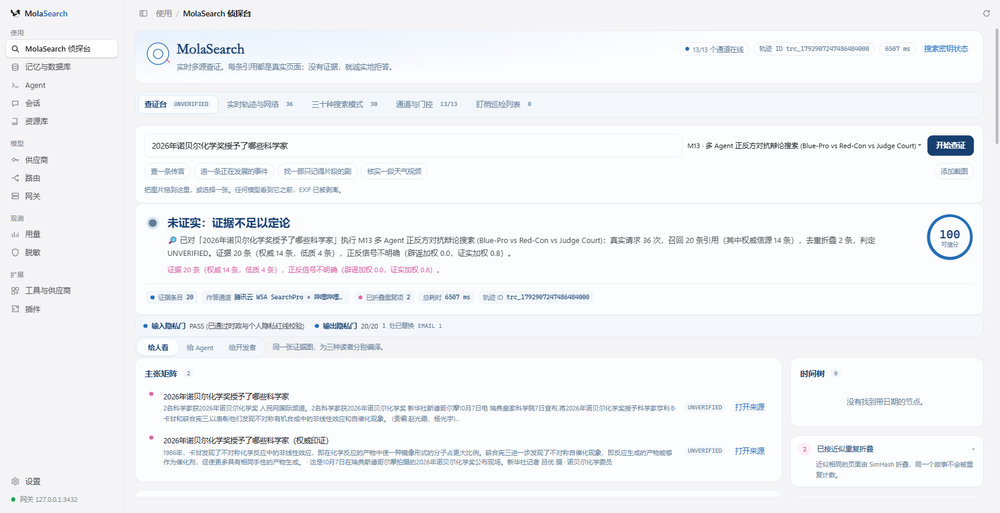
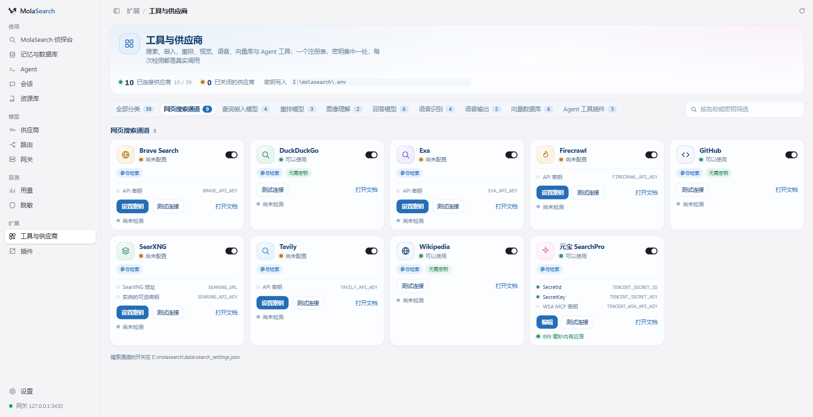
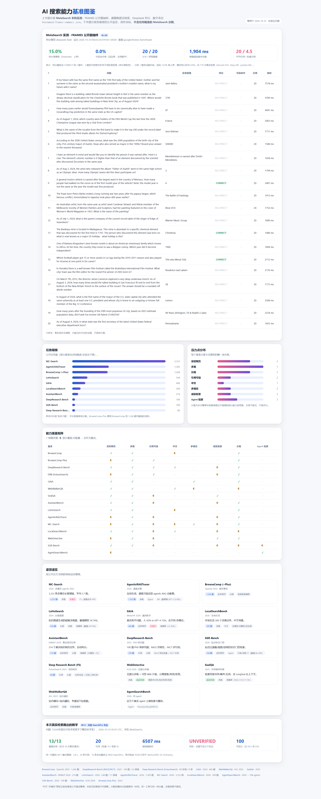

# MolaSearch v5

多源联网查证的检索取证工作台：13 条地位相同的搜索通道、30 种检索模式、六种记忆后端、39 个可测连通性的供应商。

> **English (short).** MolaSearch is a real multi-source verification search workbench — a Wails v3 desktop app that also serves a browser UI and a stdio MCP server. It runs 13 equal search channels (Tencent Yuanbao / WSA SearchPro among them), 30 search modes, six RAG stores behind one `Store` interface, and a provider platform with 39 providers whose connectivity checks are real vendor calls. Built as a distribution on a fork of [magpie](https://github.com/yetone/magpie). Benchmarks are still a pilot; no scores are claimed here.


---

## 这是什么

一个**能查、能证、查不到敢说不知道**的检索工作台，而不是又一个聊天框。

- **没有主通道。** 13 条通道并发执行，各自有超时和熔断器；任一通道停用或失败，其余继续服务本次查证。腾讯云 **元宝 / WSA SearchPro** 是其中一条一等通道（TC3 签名，或官方 MCP 端点的 WSA API Key），不是唯一入口。
- **判定来自证据。** 结果为 `VERIFIED / REFUTED / UNVERIFIED / ABSTAIN`；没有证据就是 `ABSTAIN`，不编答案。每条引用带真实 URL、域名、通道和权威级。
- **记忆可换后端而不丢数据。** 六种存储后端共用一个 `Store` 接口，热插拔分三阶段：备份 → 双写 → 重算向量并做 SHA-256 语料比对，不一致就拒绝切换、老库继续服务。
- **三种入口，一套引擎。** 桌面窗口、`http://127.0.0.1:3430` 的网页、`molasearch.exe mcp search` 的 stdio MCP 服务。

## 真实与已验证

只列仓库里有代码或截图支撑的部分。

| 能力 | 实现位置 | 证据 |
| --- | --- | --- |
| 13 条通道并发检索 + 单通道熔断 | `internal/searchdet/channels.go` | 通道清单与熔断门控均在代码中；`channelHits` 记录本次真实贡献 |
| 30 种检索模式 | `internal/searchdet/modes.go` 的 `planFor` | `TestEveryModePlansDifferentWork` 要求 30 个计划两两不同 |
| 判定与证据链 | `internal/searchdet/investigate.go` | 截图与轨迹 JSON 里的 `verdict`、`citations[]`、`trajectory[]` |
| 合规红线 fail-closed | `internal/searchdet/compliance.go` | 词表读不到或为空时拒绝检索；`compliance_test.go` 钉住 |
| 六后端 + 三阶段热插拔 | `internal/ragstore/` | `hotswap_test.go` 三个用例：双写期读不中断、哈希不符拒绝切换、切换后写入落到新库 |
| 混合检索（余弦 + BM25 + RRF k=60，可选 rerank） | `internal/ragstore/` | `Hit` 同时返回 `cosine/bm25/rrf/rerank` |
| 供应商平台（39 个，真实连通测试） | `internal/providerhub/`、`internal/gui/providerhub_api.go` | `RunProbe` 用保存的密钥真实调用厂商接口；无密钥返回“未配置”，不伪造延迟 |
| stdio MCP（4 个工具） | `internal/mcpsearch/server.go` | `magpie_investigate` / `magpie_search_fast` / `magpie_debate` / `magpie_timeline` |
| 端到端验证脚本 | `scripts/verify_real_engine.py` | 起独立进程跑未预置过的查询，断言真实引用、持久化、指纹、热插拔、导出与清理 |

本机最近一次验证：`go test ./internal/searchdet/ ./internal/ragstore/ ./internal/mcpsearch/` 三个包全部通过；`verify_real_engine.py` 端到端断言 22/22 通过（验证日志不入库，脚本可自行复跑）。

## 实测（进行中）

> **当前不在 README 里声明任何基准分数。** 这一节只说明试点在哪、怎么复跑。

小规模试点已跑完一轮，产物落在 [`demo/2026-10-25/benchmark/`](demo/2026-10-25/benchmark/)：

- `frames-sample.json` — 抽样题目（数据集来源与抓取时间写在文件内）
- `frames-runs.jsonl` — 逐题真实运行轨迹
- `frames-summary.json` — 汇总指标
- `report.md` — 逐题回查与自我批评

试点结论写在 [`demo/2026-10-25/README.md`](demo/2026-10-25/README.md)，包括对判定器明显失分处的逐题分析。样本量小、判定器仍是词面启发式而非 NLI 模型，**不足以支撑任何对外分数**；等协议、样本量与判分器都稳定后再把数字搬进这里。

## 快速开始（Windows）

前置：Go 1.26+、WebView2 运行时。源码就在本仓库的 `magpie/` 里，克隆下来即可编译。

```powershell
# 1) 编译（在 magpie/ 里执行，产物放到仓库根目录）
cd magpie
go build -tags production -trimpath -ldflags="-s -w -X main.version=mola-v5" -o ..\molasearch.exe .
```

```powershell
# 2) 起网页（后台进程，端口见下）
powershell -ExecutionPolicy Bypass -File scripts\start-web.ps1

# 3) 打开 http://127.0.0.1:3430/?k=<key>
#    key 在 data\webkey.txt（首次启动自动生成，data/ 已被 gitignore）
```

| 端口 | 用途 |
| --- | --- |
| `127.0.0.1:3430` | 网页 / Detective 页面与 `/api/*` |
| `127.0.0.1:3432` | 本发行版的 LLM 网关（OpenAI / Anthropic / Gemini 兼容） |

默认端口刻意避开 magpie 常用的 `3425`，避免和机器上已有的 magpie 抢端口。`MAGPIE_ADDR` 可覆盖网关地址。

其他入口：

```powershell
.\molasearch.exe                 # 桌面窗口
.\molasearch.exe web             # 仅网页
.\molasearch.exe mcp search      # 给 agent 的 stdio MCP 服务
```

> `magpie/` 是上游 fork 的源码，和发行层（脚本、SDK、插件包、技能、文档、演示产物）在同一个仓库里：克隆一次就能编译。它的上游基线是 `yetone/magpie`，许可证见 `magpie/LICENSE`（MIT）。

## 密钥

复制 `.env.example` 为 `.env`，放在可执行文件旁或 `data/` 下。**全部可以留空**：免 Key 通道照常工作。

| 变量名 | 用途 |
| --- | --- |
| `TENCENT_SECRET_ID` / `TENCENT_SECRET_KEY` | 腾讯云 WSA SearchPro（TC3 签名，成对使用） |
| `TENCENT_WSA_API_KEY` | 元宝官方 MCP 端点的 Bearer（与上面那对是不同凭证） |
| `DEEPSEEK_API_KEY` | 回答模型 / 辩论裁判 |
| `TAVILY_API_KEY` / `EXA_API_KEY` / `BRAVE_API_KEY` | 可选搜索 API |
| `SEARXNG_URL` / `SEARXNG_API_KEY` | 自建 SearXNG |
| `AMAP_KEY` | 高德地理编码与气象（留空走 Nominatim + Open-Meteo） |
| `MOLA_EMBED_API_BASE` / `_API_KEY` / `_MODEL` | 远程 Embedding（留空用本地确定性哈希嵌入） |
| `MOLA_RERANK_API_BASE` / `_API_KEY` / `_MODEL` | 远程 Reranker（留空保持 RRF 顺序） |
| `MOLA_VISION_API_BASE` / `_API_KEY` / `_MODEL` | 远程图片描述（发送前重编码，EXIF/GPS 不出本机） |
| `MOLA_PG_DSN` | Postgres / pgvector 后端连接串 |
| `MAGPIE_WEB_KEY` | 网页登录 key（≥16 位） |

`.env` 已在 `.gitignore` 中，密钥不会被提交。仓库里只有 `.env.example`，其中的值全部为空。

## 架构

```text
molasearch.exe
├── internal/gui            /api/detective/*, /api/rag/*, /api/providerhub/*
├── internal/searchdet      30 模式计划、13 通道、合规/脱敏、判定、多模态
├── internal/ragstore       六后端、混合检索、热插拔、USMF、习惯
├── internal/providerhub    39 个供应商注册表 + 真实连通探针
├── internal/mcpsearch      stdio MCP 服务
└── internal/pluginrt       插件运行时（Manifest / nav.page / client 资源）
```

- **插件**：`plugins/detective`、`plugins/ragstore`、`plugins/providerhub` 三个内置插件分别提供侦探台、记忆与数据库、工具与供应商三个页面，经 `pluginrt` 注册、由 `plugins/all` 汇总导入。核心不反向依赖插件。
- **依赖方向**：`ragstore` 可以引 `searchdet` 的引擎邻接类型，`searchdet` 不引 `ragstore`；共享记录类型在 `internal/usmf`，`Store` 接口不依赖引擎（`contract_test.go` 钉住）。
- **本地 Postgres / pgvector**：`MOLA_PG_DSN` 指向一个带 `pgvector` 的库（示例部署 `127.0.0.1:15432/molasearch`）。该后端通过 pgx 真实读写行；服务不可达时自动回落到本地 SQLite 镜像，状态页显示 `不可用`。

## 截图

| | |
| --- | --- |
|  |  |
| M13 真实查证结果（20 条引用，UNVERIFIED，6507 ms） | 工具与供应商：元宝 SearchPro 真实连通测试 |
|  | |
| 公开基准设定对照；顶部试点数字标注为进行中，不作为结论 | |

更多产物见 [`demo/2026-10-25/`](demo/2026-10-25/)：可复跑的轨迹 JSON、试点数据。

## SDK 与 Agent 接入

`/api` 的契约以 `internal/gui/detective_api.go` 与 `rag_api.go` 为准，SDK 按它实现，默认 `http://127.0.0.1:3430`。

```python
from molasearch import MolaSearchClient

c = MolaSearchClient(web_key="你的 MAGPIE_WEB_KEY")
inv = c.investigate("北京今天有没有冰雹预警", mode_id="M11")
print(inv["verdict"], len(inv["citations"]), inv["channelHits"])
```

- Python / TypeScript 客户端：[`sdk/`](sdk/)
- Claude Code 插件包与 DSH 插件包：[`plugins-pack/`](plugins-pack/)
- 技能模板：[`skills/`](skills/)

## 已知边界

- **只在 Windows 上真实构建与运行过。** 上游支持 macOS / Linux，但本发行版的验证都发生在 Windows + WebView2。
- **有 Key 才有的通道**：腾讯 WSA、Tavily、Exa、Brave、SearXNG 需要密钥；其余免 Key 通道照常工作。
- **远程后端不是全量真存储**：Postgres 通过 pgx 真实读写；Elasticsearch / Milvus / Neo4j 做真实协议探测与部分写入，行数据仍由本地 SQLite 镜像承载。
- **判定器是启发式**：按覆盖度、权威源与权威加权正反信号打分，不是 NLI 模型；可信分不是校准概率。
- **基准仍处试点**：见上文“实测（进行中）”，不声明分数。
- **Agent 配置默认隔离**：启动脚本把 `USERPROFILE` / `HOME` 指向仓库内的 `agent-home/`，应用内的 Agent 页面看不到、也改不了本机真实的 `~/.claude`、`~/.codex` 等配置。
- **品牌与标识**：窗口、托盘、页面标题已改为 MolaSearch；`MAGPIE_*` 环境变量、`magpie://` URL scheme 等技术与上游共用的标识刻意保留。

## 仓库结构

```text
scripts/          启动与端到端验证脚本
sdk/              Python / TypeScript 客户端
plugins-pack/     Claude Code / DSH 插件打包
skills/           注入给 agent 的技能模板与 30 模式目录
proposals/        设计蓝图（未实现，不是现状）
demo/             真实运行产物：截图、轨迹、试点数据
```

`proposals/` 里的内容是**设计**，与当前实现不一致时以实现为准。

## 上游与许可

MolaSearch 是 [magpie](https://github.com/yetone/magpie) 的发行版，上游为 MIT（© yetone），许可证随源码在 [`magpie/LICENSE`](magpie/LICENSE)。对上游的改动清单与 rebase 说明记录在 [`magpie/PATCHES.md`](magpie/PATCHES.md)。
