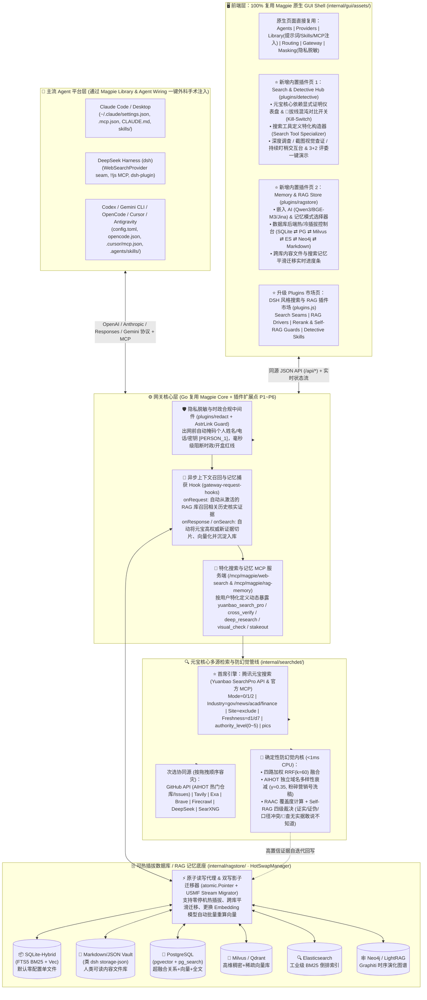
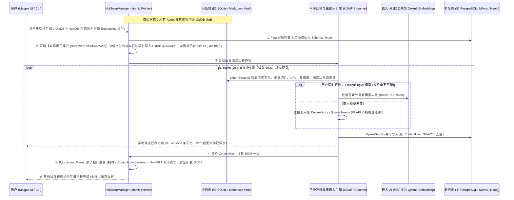
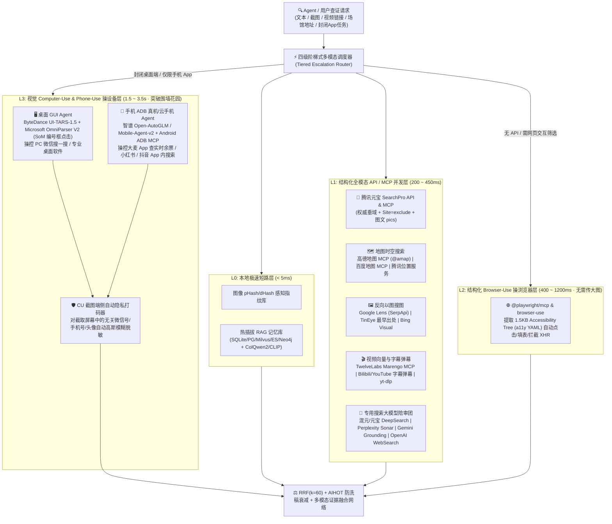
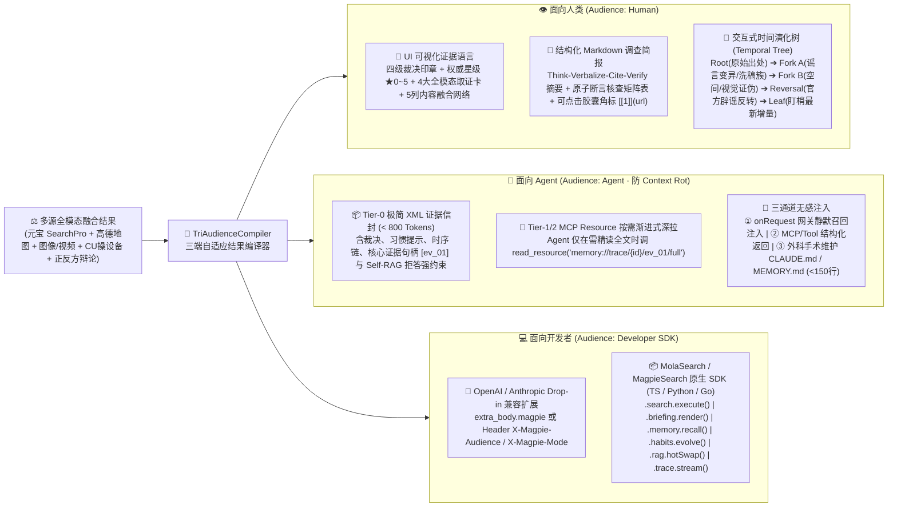

# 🕵️‍♂️ 侦探赛道｜「Magpie-Search (元宝侦探搜索网关)」全栈架构设计蓝图 (v3.5 五维热插拔融合定稿)

> **核心定位一句话**：专为 AI Agent 打造的**「多网关 · 多渠道 · 多 Tools · 多 Agent 辩论 · 24 种热插拔搜索模式（Skills/MCP）· 可热冷插拔 RAG 记忆库 · DSH 实时轨迹与可视化搜索内容网络融合网关」**。  
> **设计哲学**：**100% 继承并直接复用 `yetone/magpie` 的原生前端 UI 与网关底座代码**（已拉取至 `E:\yuanbao_search\_ref\magpie`），深度融合 **`deepseek-ai/deepseek-harness (dsh)` 的实时执行轨迹与插件市场机制**，将「少点幻觉，多点搜索（元宝 SearchPro/MCP 核心驱动）」赋能给电脑上的每一个主流 Agent（Claude Code、Codex、dsh、Gemini CLI、OpenCode、Cursor、Antigravity 等）。

---

## 一、为什么 v3.0 架构是侦探赛道的「降维打击」形态？

相比于从零手搓一个孤立的聊天网页，基于 **`yetone/magpie` + `dsh` 插件化思想** 构建的 **Agent 专用搜索与记忆网关** 具备三大不可替代的杀手级优势：

1. **一次配置，全网 40+ 主流 Agent 同时获得「元宝侦探查证能力」**：
   - 直接复用 `magpie` 的 `internal/agent` 与 `internal/library` 外科手术配置写入引擎，把**特化搜索工具 (`Tools`)**、**防幻觉侦探提示词 (`Instructions`)**、**查证技能包 (`Skills/SKILL.md`)** 和 **搜索记忆 `MCP Server`** 一键无损注入到 `Claude Code`、`Codex`、`DeepSeek Harness (dsh)`、`Cursor`、`Gemini CLI`、`OpenCode` 等所有主流平台。
2. **高度自由的后端选配与「数据库/搜索记忆热冷插拔平滑迁移」**：
   - 用户可以像在 Magpie 里选大模型一样，在界面上自由选配：**用什么嵌入/重排 AI (`Embedding/Reranker`)**、**用什么记忆模式 (`Memory Mode`)**、**用什么数据库/RAG 形式 (`SQLite / Markdown Vault / PostgreSQL / Milvus / Elasticsearch / Neo4j`)**；
   - 独创 **USMF（统一搜索记忆交换格式）与双写影子热插拔引擎**：在不同数据库之间切换或更换 Embedding 模型时，**内容文件与搜索记忆自动平滑迁移、自动重算向量，业务 0 停机热插拔**！
3. **100% 原汁原味复用 `yetone/magpie` 工业级前端与内核代码**：
   - 直接复用 `magpie/internal/gui/assets/`（`index.html`、`app.css`、`kernel.js`、`app.js`、`plugins.js`、`library/client.js`、`redact/page.js`），通过 Magpie 原生的 `window.magpie.plugin(id, setup)` 与 `ctx.ui` 组件套件扩展侦探专属页面，视觉、交互、i18n 多语言与原生 Magpie 保持 100% 一致！

---

## 二、v3.0 整体系统架构图（Magpie-Native + DSH Plugin Seams）



---

## 三、六大核心子系统详细设计

### 3.1 直接复用 `magpie` 的模块清单 vs 新增扩展模块清单

通过对 `E:\yuanbao_search\_ref\magpie` 源码的完整梳理，我们将复用率提升至 **85% 以上**，只聚焦开发最核心的「元宝侦探特化、可插拔 RAG 记忆迁移与插件市场」：

| 子系统层级 | 直接 100% 复用的 `yetone/magpie` 现有包与文件 | 本项目新增 / 特化升级的包与文件 |
|---|---|---|
| **前端 UI 壳与样式体系** | • `internal/gui/assets/index.html`<br>• `internal/gui/assets/app.css` (353KB 完整设计系统)<br>• `internal/gui/assets/kernel.js` (`window.magpie.plugin` 内核与 `ctx.ui` 套件)<br>• `internal/gui/assets/app.js`, `i18n.js`, `plugins.js`, `pluginpages.js` | • `assets/plugins/detective/` (`client.js`, `detective.css`, `i18n.js`)：**侦探搜索中枢页**（含元宝显式证明仪表盘、拔线开关、工具特化器、3+2 演示台）<br>• `assets/plugins/ragstore/` (`client.js`, `ragstore.css`, `i18n.js`)：**记忆与数据库热冷插拔迁移中心页** |
| **Agent 配置外科手术注入** | • `internal/agent/`（40+ 主流 Agent 自动探测与模型/BaseURL 绑定）<br>• `internal/library/`（`instructions.go`, `mcp.go`, `skills.go`, `hooks.go`, `subagents.go` 外科手术同步与备份恢复） | • `internal/library/detective_presets.go`：预置**「元宝侦探提示词包」、「5 大侦探 `SKILL.md` 技能包」与「特化搜索/记忆 MCP 自动挂载器」**，支持一键注入 Claude Code / dsh / Codex / Cursor 等 |
| **端侧隐私脱敏与合规拦截** | • `internal/redact/` & `internal/masking/` & `plugins/redact/`（出网前自动掩码密钥、PII 个人数据与自定义敏感词，响应自动还原，并提供 `Masking` 审计页） | • `internal/redact/compliance_guard.go`：强化赛题专属**「时政与个人开盒红线硬阻断 (`BLOCK`)」** + **群聊截图/传言个人信息自动脱敏 (`[PERSON_1]`, `[PHONE_1]`)** |
| **多源搜索与工具网关** | • `internal/provider/search_api.go`（多 Key 轮询、故障静默切换、拖拽排序）<br>• `internal/gateway/search_api.go` & `search_mcp.go`（`/mcp/magpie/web-search` 端点） | • `internal/gateway/search_yuanbao.go`：**接入腾讯元宝 `SearchPro` API 与官方 MCP**，支持 `Mode`/`Industry`/`Site=exclude`/`Freshness`/`authority_level`/`pics`<br>• `internal/searchdet/`：**搜索工具定义特化器 + RRF($k=60$) + AIHOT 独立域名衰减 + Self-RAG 敢说不知道 + 截图查证 + 持续盯梢** |
| **可插拔 RAG 与数据库平滑迁移** | • `internal/gateway/gateway_hooks.go`（`onRequest` 上下文召回与 `onResponse` 异步捕获机制）<br>• `internal/sync/`（WebDAV / S3 / GitHub 加密备份同步） | • `internal/ragstore/`（全新核心包）：<br>  - `driver.go`（统一数据库/RAG 驱动接口）<br>  - `drivers/`（`sqlite`, `vault_md`, `postgres`, `milvus`, `elasticsearch`, `neo4j` 6 大驱动）<br>  - `hotswap.go`（零停机双写热插拔与向量自动重算）<br>  - `migrate.go`（USMF 内容文件与搜索记忆跨库平滑迁移 & 冷插拔归档包导出/导入） |

---

### 3.2 搜索工具的定义特化（Search Tool Specialization）

在原生 Magpie 中，所有 Agent 拿到的搜索工具都是千篇一律的 `web_search(query: string)`。而在我们的 **Magpie-Search** 中，用户可以在 UI 上对搜索工具进行**深度定义特化（Tool Specialization）**，并通过 `/mcp/magpie/web-search` 或网关内置 Tool Injection 动态暴露给不同 Agent：

#### （1）内置 5 大特化侦探搜索工具（开箱即用）
| 工具名称 (Tool Name) | 特化参数 Schema (Input Schema) | 底层执行管线与返回值特化 |
|---|---|---|
| **`yuanbao_search_pro`** | `query`, `mode (0=全网\|1=权威\|2=混合)`, `industry (gov\|news\|acad\|finance)`, `site_include`, `site_exclude (最多5个域名)`, `freshness (d1\|d7\|m1\|y1)`, `cnt (10..50)` | 直通元宝 SearchPro API/MCP，返回每条证据的 **`authority_level (0~5 官方权威星级)`**、`score (0~1)`、`passage`、`content`、`pics (原图+图注)` 与可点击 `url`。 |
| **`detective_cross_verify`** | `claim (待查证说法)`, `strict_authority (bool)`, `require_independent_sources (int, 默认>=2)` | **三源交叉查证**：并发请求 ① 元宝权威垂域 (`Industry=gov\|acad`) + ② 元宝反向排他通道 (`Site=exclude:首批主域名`) + ③ 本地激活的 RAG 记忆库与次选源（GitHub/Tavily/Exa）；执行 **AIHOT 独立域名多样性衰减 ($\gamma=0.35$)** 与 **Self-RAG 四级裁决 (`VERIFIED` / `REFUTED` / `CONTESTED` / `ABSTAIN 查不到敢说不知道`)**。 |
| **`detective_deep_investigate`** | `question (复杂课题/模糊剧情)`, `max_hops (1..4)`, `search_mode (simple\|cross\|deep\|compare)` | **多跳深度调查（AREX + RAAC 循环）**：自动拆解子问题树 → 多轮元宝搜索 + RAG 图谱扩散 → 交叉审计覆盖度与新颖度 → 产出带完整证据链与正反口径对比表的结构化调查报告，并将新证据自动写入当前激活的数据库后端。 |
| **`detective_visual_check`** | `image_path_or_url`, `context_hint` | **截图/视频关键帧查证（Aletheia 范式）**：先调多模态 VLM 识别图中文字断言、发布者、时间戳及 P 图伪造疑点 → 经 `redact` 剥离个人隐私 → 自动调用 `detective_cross_verify` + 元宝 `pics` 视觉比对核实真伪。 |
| **`detective_stakeout`** | `action (add\|list\|check_now\|remove)`, `topic`, `query`, `freshness (d1\|d7)`, `notify_on_reversal (bool)` | **持续盯梢巡检**：利用元宝 `Freshness=d1` 每日增量检索，对比 RAG 记忆库中的历史结论哈希与时序边；一旦发现新官方通报或票务/版本变化，立即记录 `TimelineDiff` 并触发提醒。 |

#### （2）用户自定义特化搜索工具构造器（Custom Tool Specializer）
用户可在前端 `Search Hub → Tool Specializer` 面板中点击 `＋ New Specialized Search Tool`，通过可视化表单定义一个特化工具并绑定给指定 Agent（例如为 `Claude Code` 注入 `verify_tech_claim`，为微信机器人注入 `check_family_rumor`）：
```json
{
  "tool_name": "check_family_rumor",
  "description": "专门用于核查家族群养生、食品安全、社会民生传言的真伪，强制优先检索政务与学术权威信源，无确凿证据时必须拒答说不知道。",
  "pinned_yuanbao_params": {
    "mode": 2,
    "industry": "gov,acad,news",
    "cnt": 20
  },
  "rag_memory_policy": {
    "recall_first": true,
    "min_authority_to_memorize": 3,
    "dedup_diversity_gamma": 0.35
  },
  "self_rag_guard": {
    "abstain_threshold": 0.45,
    "require_clickable_citations": true
  },
  "target_agents": ["claude-code", "dsh", "codex", "openclaw"]
}
```

---

### 3.3 自由选配：嵌入 AI + 记忆模式 + 数据库/RAG 后端 + 热/冷插拔平滑迁移

这是本次架构重构最具技术深度的模块（位于 `internal/ragstore/`，前端对应 `plugins/ragstore` 页面）。

#### （1）三维自由选配矩阵（像在 Magpie 里选模型一样丝滑）
1. **维度一：嵌入与重排 AI 选配 (`Embedding & Reranker AI`)**
   - 直接复用 Magpie `providers.json` 中已配置的厂商与本地服务：
   - **可选嵌入模型**：`Qwen/Qwen3-Embedding-8B`、`BAAI/bge-m3`、`Tencent/Hunyuan-Embedding`、`jinaai/jina-embeddings-v3`、`voyage-3`、`text-embedding-3-large`、`gemini-embedding-2` 或本地 `Ollama / vLLM / LM Studio` 模型；
   - **可选重排策略**：`Built-in RRF(k=60) + Yuanbao Authority + AIHOT Diversity`（0ms 极速默认）或外接 `BAAI/bge-reranker-v2-m3` / `jina-reranker-v2` / `cohere-rerank-v3.5`。
2. **维度二：搜索记忆模式 (`Search Memory Mode`)**
   - `Stateless (无状态直通)`：只查不存；
   - `Episodic Session (会话级记忆)`：自动关联当前 Agent 会话 (`session_id`) 的搜索上下文；
   - `Self-Iterating Evidence KB (自迭代证据知识库)`：**越查越聪明**——每次元宝搜索经交叉核实的证据自动切片、向量化、提取元数据入库；下次任何 Agent 查相似问题时，`<10ms` 召回本地已核实证据 + 元宝 `Freshness=d1` 补充最新动态；
   - `Temporal GraphRAG (时序演化图谱模式)`：参考 `Graphiti` + `LightRAG`，自动构建 `Claim ⇄ Evidence ⇄ Source` 时序关系图，精准追踪“谣言何时产生、何时被哪条权威证据反转”。
3. **维度三：数据库 / RAG 后端形态 (`Database / RAG Backend Driver`)**
   - 支持 **6 种主流数据库与文件形态**，通过统一的 `ragstore.Driver` 接口抽象：
     1. **`sqlite-hybrid`（内置默认·零外部依赖）**：基于单文件 SQLite，同时具备全文检索（FTS5 BM25）、向量检索（Cosine ANN）与关系表；
     2. **`markdown-vault`（本地内容文件库·类 `dsh storage-json`）**：将每条核实过的搜索记忆保存为结构化 Markdown 文件（含 YAML Frontmatter 元数据：来源 URL、元宝权威度星级、核查裁决、时间戳）+ `.vectors.jsonl` 索引文件 + `attachments/` 原图附件夹，用户可直接用 Obsidian / VS Code 打开阅读和编辑！
     3. **`postgres-hybrid`（超融合单库生产级）**：连接 PostgreSQL（支持 `pgvector` + `tsvector/pg_search` + JSONB 图表）；
     4. **`milvus`（大规模向量数据库）**：通过 Milvus v2 RESTful API 连接独立或云端 Milvus / Zilliz Cloud 集群；
     5. **`elasticsearch`（工业级全文+向量混合引擎）**：连接 ES 8.x，使用原生 BM25 + kNN RRF 检索；
     6. **`neo4j-graph`（原生图数据库 GraphRAG）**：通过 Neo4j HTTP Cypher API 存储和扩散查询多跳证据链。

#### （2）核心黑科技：跨数据库内容文件与搜索记忆平滑迁移 + 热/冷插拔（`Hot/Cold Swap Engine`）



- **统一搜索记忆交换格式（`USMF` — `CanonicalMemoryRecord`）**：
  ```go
  type CanonicalMemoryRecord struct {
      ID              string            `json:"id"`
      ContentHash     string            `json:"contentHash"`     // SHA-256 幂等去重指纹
      CreatedAt       int64             `json:"createdAt"`
      ValidFrom       int64             `json:"validFrom"`       // Graphiti 时序生效时间
      InvalidAt       int64             `json:"invalidAt,omitempty"` // 证据反转失效时间
      QueryOrigin     string            `json:"queryOrigin"`     // 触发该记忆的原始问题
      Claim           string            `json:"claim"`           // 核查的原子断言
      Verdict         string            `json:"verdict"`         // VERIFIED | REFUTED | CONTESTED | ABSTAIN
      Title           string            `json:"title"`
      URL             string            `json:"url"`             // 必可点击的原网页地址
      Site            string            `json:"site"`
      PublishDate     string            `json:"publishDate"`
      Passage         string            `json:"passage"`         // 核心证据摘要
      FullMarkdown    string            `json:"fullMarkdown,omitempty"` // 完整内容文件正文
      YuanbaoScore    float64           `json:"yuanbaoScore"`    // 元宝原生相关性 0~1
      AuthorityLevel  int               `json:"authorityLevel"`  // 元宝官方权威度 0~5
      Industry        string            `json:"industry,omitempty"`
      EmbeddingModel  string            `json:"embeddingModel"`  // 如 "qwen3-embedding-8b"
      VectorDim       int               `json:"vectorDim"`
      DenseVector     []float32         `json:"denseVector,omitempty"`
      KeywordsBM25    []string          `json:"keywordsBm25,omitempty"`
      GraphEdges      []GraphEdge       `json:"graphEdges,omitempty"` // SUPPORTS / CONTRADICTS / EVOLVED_INTO
      Attachments     []AttachmentAsset `json:"attachments,omitempty"` // 关联截图或原网页图片文件
  }
  ```
- **❄️ 冷插拔（Cold-Swap）**：
  - 点击 `Export Memory Bundle (.magpie-rag.jsonl / .tar.zst)`，可将任意数据库（如 `Milvus + Neo4j`）中的全部搜索记忆、向量与截图内容文件导出为标准便携归档包；
  - 将该归档包拖入任意另一台电脑的 Magpie，或放入 `library/memories/` 目录，即可**冷插拔挂载**到任何目标数据库（如本地零配置的 `SQLite` 或 `Markdown Vault`）！

---

### 3.4 类 `DeepSeek Harness (dsh)` 的插件市场设计（`Plugins › Discover & Built-in`）

我们直接扩展 `magpie/internal/gui/assets/plugins.js` 与 `internal/pluginrt`，将 Magpie 的插件系统升级为涵盖 **`dsh` 四大能力接缝（Seams）** 的统一市场：

| 插件接缝分类 (Seam Chip) | 预置与社区可安装插件列表 | 作用与热插拔方式 |
|---|---|---|
| **`🔍 Web & Vertical Search` (全网与垂域搜索源插件)** | • **`@veritas/search-yuanbao-pro`**（⭐ **官方核心必装**：元宝 SearchPro API + MCP 双模）<br>• `@veritas/search-github-aihot`（GitHub 热门仓库/Issues 实时检索与 AIHOT 热度聚合）<br>• 原生保留：`Tavily`、`Exa`、`Brave`、`Firecrawl`、`You.com`、`DeepSeek`、`SearXNG` | 支持拖拽调整调用优先级、多 Key 轮转、单开关热启停（含「拔掉元宝搜索」混沌对比测试开关）。 |
| **`🗺️🖼️🎬 Multimodal & Geo Search` (地图/图片/视频搜索插件)** | • **`@veritas/geo-amap-mcp`**（高德地图 MCP / Web API：POI 检索、经纬度、周边拓扑、实时历史天气）<br>• **`@veritas/geo-baidumap-mcp`**（百度地图 MCP：地点与路径矩阵交叉验证）<br>• **`@veritas/image-lens-tineye`**（Google Lens `SerpApi` + `TinEye` 最早发布时间溯源 + `Bing Visual` + `ColQwen2`）<br>• **`@veritas/video-twelvelabs-bili`**（`TwelveLabs Marengo 3.0 MCP` + `Bilibili/YouTube` 字幕高能弹幕 + `FFmpeg 3x3 九宫格抽帧`） | 热插拔接入多模态搜索供应商，支持按查询意图（含地址/配图/视频链接）自动路由并发调用。 |
| **`🖥️📱 Computer-Use & Phone-Use` (操设备搜索插件)** | • **`@veritas/cu-playwright-browser`**（Microsoft `@playwright/mcp` + `browser-use`：`a11y` 语义树极速操控网页）<br>• **`@veritas/cu-uitars-desktop`**（ByteDance `UI-TARS-1.5` + Microsoft `OmniParser V2 SoM` 操控 PC 桌面软件/微信搜一搜）<br>• **`@veritas/cu-autoglm-adb`**（智谱 `Open-AutoGLM` / `Mobile-Agent-v2` + `Android ADB` 真机/模拟器操控大麦 App 查票、小红书/抖音深层搜索） | 三级阶梯式按需唤醒，支持实时回传设备屏幕/DOM 快照并自动经 `CU Visual Redact` 端侧隐私打码！ |
| **`🧠 Search-Grounded Models` (专用搜索大模型插件)** | • `Tencent Hunyuan/Yuanbao DeepSearch`、`Perplexity Sonar/Agent API`、`OpenAI Responses (web_search_preview)`、`Google Gemini 2.5 Search Grounding`、`xAI Grok-3 Live Search` | 在 Magpie `Providers` 层一键挂载为搜索原生模型陪审团，支持跨模型内联引用蒸馏。 |
| **`🗄️ RAG & DB Backends` (数据库与存储插件)** | • `@veritas/rag-sqlite-hybrid`（内置默认：FTS5 BM25 + Vector）<br>• `@veritas/rag-markdown-vault`（类 `dsh storage-json`：本地 Markdown 证据文件库）<br>• `@veritas/rag-postgres-parade`（PG + pgvector + 全文 + 图谱）<br>• `@veritas/rag-milvus`（Milvus 2.4+ 向量库驱动）<br>• `@veritas/rag-elasticsearch`（ES 8+ 倒排与混合检索驱动）<br>• `@veritas/rag-neo4j-graphiti`（Neo4j 时序演化证据图谱驱动） | 支持在 UI 上一键填写连接串、测试延迟，并点击 **「🔥 Hot-Swap & Migrate Here」** 将现有搜索记忆零停机平滑迁移过去！ |
| **`🛡️ Rerank & Anti-Hallucination` (减幻觉增强插件)** | • `@veritas/rerank-rrf-aihot`（四路 RRF $k=60$ 融合 + AIHOT 独立域名防洗稿衰减 $\gamma=0.35$）<br>• `@veritas/guard-selfrag-abstain`（Self-RAG 证据充分度门控：不足阈值强制返回“查无实据·敢说不知道”）<br>• `@veritas/guard-astrlink-privacy`（时政与个人开盒红线阻断 + 群聊/CU 截图姓名/手机号双向脱敏） | 挂载在网关搜索与响应管道上，可实时调节严格度阈值并在界面查看拦截/脱敏审计记录。 |
| **`🕵️ 30 Search Modes & Skills` (30 种搜索模式技能与工具包)** | • **7 大搜索族系 × 30 种标准热插拔搜索模式插件（`M01`~`M30`）**<br>• `@veritas/pack-rumor-detective` · `@veritas/pack-visual-factcheck` · `@veritas/pack-stakeout-watcher` · `@veritas/pack-cu-ticket-hunter` | 安装后自动注册到 `Library`，同时生成标准 `SKILL.md`、MCP Tool 与 `dsh` 算子，可一键勾选注入给 `Claude Code`、`dsh`、`Codex`、`Cursor` 等任意 Agent！ |

---

### 3.5 24 种热插拔搜索模式架构（`SearchModeRegistry`）与 `Skills / MCP / DSH` 自动封装引擎

为了彻底贯彻**「热插件拔插」**理念并覆盖业界最广泛的搜索范式，我们在 `internal/searchmodes/` 中设计了统一的 **`SearchModePlugin` 热插拔接口**，将 **6 大族系共 24 种搜索模式** 标准化封装。任何模式既可在网关内直接运行，又可一键导出/注入为 **Agent `SKILL.md`**、**MCP Tool (`/mcp/magpie/search-modes`)** 与 **`dsh` Cordis 算子**：

```go
// SearchModePlugin 是所有 24+ 种搜索模式的热插拔统一接口
type SearchModePlugin interface {
    ID() string                     // 如 "M01", "M13", "M21"
    Slug() string                   // 如 "search-direct-fast", "search-multiagent-debate"
    Family() string                 // augmented | heuristic | recursive | debate_creative | temporal_topic | privacy_multimodal
    Name() string                   // 中文/英文模式名称
    Description() string            // 适用场景与算法说明
    DefaultYuanbaoParams() YuanbaoSearchSpec // 该模式特化的元宝 SearchPro 参数模板
    Execute(ctx context.Context, req *SearchRequest, rt *FusionRuntime) (*SearchResponse, error)
    ExportSkillMD() string          // 自动生成可注入 Claude Code / Cursor / Codex / Antigravity 的 SKILL.md
    ExportMCPToolSchema() MCPTool   // 自动暴露为 MCP Server 工具定义
}
```

#### 24 种热插拔搜索模式全景速查表（均可独立启停、组合编排、一键注入 Agent）
1. **基础与增强式搜索族 (`augmented`)**：
   - **`M01` 直通极速搜索 (`search-direct-fast`)**：L1 缓存短路 + 元宝 `Mode=2` 单轮极速检索。
   - **`M02` 混合增强搜索 (`search-hybrid-rag`)**：稀疏 BM25 + 稠密向量 + 元宝实时流加权 RRF ($k=60$) 融合。
   - **`M03` 假设文档增强搜索 (`search-hyde-augmented`)**：先生成假设性权威通告/答案片段再做稠密向量与元宝检索。
   - **`M04` 多查询扩展重写搜索 (`search-multi-rewrite`)**：正交改写为 3~4 个同义/专业/跨语言子查询并发召回。
2. **启发式与图谱探索搜索族 (`heuristic`)**：
   - **`M05` 启发式最佳优先 / MCTS 树搜索 (`search-heuristic-mcts`)**：按 $h(n) = \alpha \text{Authority} + \beta \text{Novelty} - \gamma \text{Depth}$ 启发式评分展开搜索树。
   - **`M06` 多跳实体桥接搜索 (`search-multihop-bridge`)**：针对模糊剧情找剧/外号找项目，先锁定中间桥接实体 $E_{\text{bridge}}$ 再精确核查。
   - **`M07` 双层知识图谱扩散搜索 (`search-graph-dual`)**：LightRAG 范式，局部实体一跳邻居 + 全局社区主题双路检索。
   - **`M08` 引文溯源顺藤摸瓜搜索 (`search-citation-snowball`)**：从二手报道提取一手出处线索，再用元宝 `Site=一手域名` 直追原始通告。
3. **自迭代、递归与反思搜索族 (`recursive`)**：
   - **`M09` 自迭代递归审计搜索 (`search-recursive-arex`)**：AREX 内外双环，对草稿中的无据断言自动追加 `Site=exclude` 递归反查并回写知识库。
   - **`M10` 检索感知自适应控制搜索 (`search-adaptive-raac`)**：实时监测新颖度 $\text{Novelty}$ 与覆盖度 $\text{Coverage}$，动态决定继续、换渠道重写或早停。
   - **`M11` 自反思防幻觉拒答搜索 (`search-selfrag-abstain`)**：引入 `[ISREL]/[ISSUP]` 门控，证据不足或无权威来源时强制触发 **`ABSTAIN（查不到敢说不知道）`**。
   - **`M12` 原子决策树搜索 (`search-deeprag-tree`)**：DeepRAG 二叉决策树，按子问题确定性动态协同参数记忆与元宝外部检索。
4. **多智能体辩论与创造性搜索族 (`debate_creative`)**：
   - **`M13` 多 Agent 正反方对抗辩论搜索 (`search-multiagent-debate`)**：蓝方取证 Agent + 红方证伪 Agent (`Site=exclude` + 反例搜索) + 大法官 Agent 同台对抗裁决。
   - **`M14` 多源陪审团交叉共识搜索 (`search-jury-consensus`)**：元宝 + GitHub + Tavily/Exa + 本地 RAG 多渠道并发，经 AIHOT 域名多样性衰减 ($\gamma=0.35$) 折叠洗稿水军。
   - **`M15` 创造性跨域类比与头脑风暴搜索 (`search-creative-abductive`)**：抽取问题第一性原理拓扑，跨学科（`Industry=acad|finance` + GitHub）搜索同构方案启发创新。
   - **`M16` 证伪优先波普尔反事实搜索 (`search-popper-falsify`)**：专门构造最严苛的反例/辟谣/漏洞查询检验假设是否能被击穿。
5. **时空、话题与垂域特化搜索族 (`temporal_topic`)**：
   - **`M17` 时间线演进与反转重构搜索 (`search-timeline-evolution`)**：按 `Freshness=y1 -> m1 -> d7 -> d1` 分段检索，结合 Graphiti 时序边重构事件反转过程。
   - **`M18` 话题聚类与全网脉络搜索 (`search-topic-cluster`)**：宽幅召回后按向量余弦聚类生成子话题簇与 AIHOT 热度脉络图。
   - **`M19` 持续盯梢增量差分搜索 (`search-stakeout-watch`)**：定时调用元宝 `Freshness=d1`，与知识库历史快照做 SimHash/立场差分并告警。
   - **`M20` 权威垂域硬锁定搜索 (`search-vertical-authority`)**：硬锁定元宝 `Mode=1` + `Industry=gov|acad|finance|news`，过滤一切 `authority_level < 3` 内容。
6. **多模态、隐私与联邦安全搜索族 (`privacy_multimodal`)**：
   - **`M21` 隐私脱敏零泄漏安全搜索 (`search-privacy-redacted`)**：`Magpie Redact + AstrLink Guard` 先脱敏个人隐私/阻断时政红线，再出网调元宝，返回后端侧还原。
   - **`M22` 视觉截图与关键帧查证搜索 (`search-visual-factcheck`)**：VLM 提取截图断言与 P 图痕迹 + 元宝 `pics` 原图与文本反向查证。
   - **`M23` 代码与开源生态取证搜索 (`search-code-forensics`)**：元宝全网技术评测检索 + GitHub Code/Issues/Releases/MCP 注册表交叉取证。
   - **`M24` 联邦多库与多网关路由融合搜索 (`search-federated-multidb`)**：跨多个热插拔数据库（SQLite/PG/Milvus/ES/Neo4j）与对等 Magpie 网关并发联邦检索融合。
7. **地图时空、音视频、搜索大模型与 Computer-Use 操设备搜索族 (`multimodal_cu_geo` · v4.0 新增)**：
   - **`M25` 高德/百度地图时空实景核验搜索 (`search-geo-amap`)**：调用高德地图 MCP (`@amap/amap-maps-mcp-server`) + 百度地图 MCP 核验传言地址、POI 真实性、场馆状态、周边地标拓扑与历史天气，协同元宝检索当地通报。
   - **`M26` 反向以图搜图与最早出处溯源搜索 (`search-image-provenance`)**：`pHash/dHash` + `Google Lens (SerpApi)` + `TinEye (最早发布时间排序)` + 元宝 `pics`，精准粉碎“旧图新炒”与裁剪篡改图。
   - **`M27` 视频九宫格关键帧与弹幕字幕搜索 (`search-video-keyframe`)**：`yt-dlp / bilibili-mcp` 提取时间轴字幕与高能弹幕 + `FFmpeg` 场景切换抽帧拼合 **带时间戳 `3x3 Contact Sheet` 九宫格** + `TwelveLabs Marengo 3.0 MCP` 视频向量定位。
   - **`M28` Computer-Use 浏览器与桌面操设备搜索 (`search-computer-use`)**：通过 `@playwright/mcp` / `browser-use` (`a11y` 语义树操控) 与 `ByteDance UI-TARS-1.5 + OmniParser V2 SoM` 操控浏览器或 PC 桌面软件（如微信 PC 版、动态选座网页）突破无 API 围墙花园并实时截屏取证。
   - **`M29` Phone-Use 手机 ADB 真机操控 App 搜索 (`search-phone-adb`)**：通过 `Open-AutoGLM (AutoGLM-Phone-9B)` / `Mobile-Agent-v2` + `Android ADB MCP` 直接操控安卓容器/真机打开 **大麦 App、小红书、抖音、封闭小程序** 搜索实时余票与深层内容并截屏回传。
   - **`M30` 多搜索大模型交叉 Grounding 蒸馏搜索 (`search-model-ensemble`)**：并发路由至 `腾讯混元/元宝 DeepSearch`、`Perplexity Sonar/Agent API`、`OpenAI Responses (web_search_preview)`、`Google Gemini 2.5 Search Grounding`、`xAI Grok-3 Live Search`，蒸馏跨模型高重合度内联引用。

---

### 3.8 全模态搜索供应商与 Computer-Use 操设备搜索热插拔子系统（`internal/multimodal/` · v4.0 核心升级）

为了将网页搜索、高德/百度地图、图片反向溯源、视频关键帧/字幕、专用搜索大模型以及 Computer-Use 操设备搜索统一纳入热插拔体系，我们设计了 **`MultimodalChannelProvider` 统一接缝** 与 **四级阶梯式性能加速管线**：



#### 四大核心性能优化机制（解决多模态与 Computer-Use “慢、贵、不稳”痛点）
1. **Accessibility Tree (`a11y`) 优先于像素截图（提速 6 倍，省 95% Token）**：在 `M28 Computer-Use` 操控网页时，优先通过 `@playwright/mcp` 读取精简无障碍语义树（仅 `~1.5KB` YAML），直接定位按钮/输入框 ref 执行点击与检索，仅在 Canvas 或取证留档时截取画面。
2. **`OmniParser V2` Set-of-Mark (`SoM`) 锚框编号化**：针对桌面软件与手机 ADB 屏幕，先用本地轻量检测器（`<15ms`）为所有 UI 控件打上数字标签 `[#1] [#2]`，模型直接输出 `tap(#2)`，彻底杜绝坐标偏移导致的重复盲点。
3. **视频「字幕弹幕先行过滤 + `FFmpeg 3x3 Contact Sheet` 九宫格拼图」**：先在 `<400ms` 内检索字幕与 B 站弹幕定位关键时间段，再用 FFmpeg `select='gt(scene,0.3)',tile=3x3` 将 9 张镜头切换关键帧带时间戳合成 1 张图送入 VLM，降低 **85% 视觉 Token 消耗**。
4. **端侧 `CU Visual Redact` 实时打码护盾**：Computer-Use / Phone-Use 截取的设备画面在进入云端模型或前端轨迹回放前，自动掩码状态栏通知、个人昵称与手机号，确保操设备搜索 100% 合规零泄漏。

---

### 3.6 多网关 · 多渠道 · 多 Tools · 多 Agent 辩论融合调度层（`Five-Axis Fusion Engine`）

系统在网关核心层实现**五维热插拔融合（Five-Axis Search Fusion）**：
1. **多网关路由 (`Multi-Gateway`)**：支持本地主网关 `Magpie-Primary`、隐私隔离网关 `AstrLink-Guard-Node` 及团队远端对等网关 `Magpie-Peer` 级联路由与配额池化。
2. **多渠道扇出 (`Multi-Channel`)**：以 **腾讯元宝 `SearchPro` API & 官方 `MCP`** 为 #1 核心引擎（断网或拔线时触发核心熔断证明），协同 `GitHub/AIHOT`、`Tavily`、`Exa`、`Brave`、`Firecrawl`、`SearXNG` 及 6 大本地/远端 RAG 数据库。
3. **多 Tools 组合 (`Multi-Tools`)**：支持在单次任务中链式或并行调用上述 24 种搜索模式工具。
4. **多 Agents 辩论法庭 (`Multi-Agent Debate Court`)**：
   - **🔵 蓝方探员 (`Pro-Investigator`)**：调用 `M02/M08/M20` 检索支持原命题的权威一手证据；
   - **🔴 红方探员 (`Con-Falsifier`)**：调用 `M16/M09` 携带 `Site=exclude:蓝方域名` 与辟谣关键词专门检索反例、撤稿与漏洞；
   - **🟣 审计官 (`AIHOT-Auditor`)**：计算独立域名多样性衰减 $\gamma^{i-1} (\gamma=0.35)$、折叠同源营销号洗稿，并校验时序先后（新通报覆盖旧传言）；
   - **⚖️ 结案大法官 (`Self-RAG Judge`)**：综合双边呈堂证供，给出 `VERIFIED（证实）`、`REFUTED（证伪）`、`CONTESTED（双边口径冲突，并列呈堂）` 或 `ABSTAIN（证据不足，敢说不知道）` 裁决。

---

### 3.7 类 `DeepSeek Harness (dsh)` 实时搜索轨迹 + 可视化搜索内容融合网络（`Live Trajectory & Content Network`）

直接继承并升级 `yetone/magpie` 的 `internal/gateway/trace.go` 与 `plugins/routing/client.js`（飞鸟路由舞台 + 实时步骤流），为每一次搜索构建**「实时轨迹瀑布流 + 可视化搜索内容关系网络」双视图**，100% 满足**「必须可视化搜索源头、搜索返回、搜索的时间」**以及**「可视化搜索内容网络的搜索融合」**：

#### （1）实时搜索轨迹数据结构（`SearchTrajectoryTrace` — 精确记录源头、返回、时间）
```go
type SearchTrajectoryTrace struct {
    TraceID        string              `json:"traceId"`
    Seq            int64               `json:"seq"`
    StartedAt      int64               `json:"startedAt"`      // 毫秒时间戳
    TotalMillis    int64               `json:"totalMillis"`    // 端到端总耗时 (ms)
    CallerAgent    string              `json:"callerAgent"`    // 搜索源头 Agent: claude-code | dsh | codex | web-ui
    SessionID      string              `json:"sessionId"`
    ActiveModeID   string              `json:"activeModeId"`   // M01 ~ M24
    ActiveModeName string              `json:"activeModeName"`
    OriginalQuery  string              `json:"originalQuery"`
    RedactedQuery  string              `json:"redactedQuery"`  // 脱敏后出网 Query
    PrivacyMasked  []MaskedEntity      `json:"privacyMasked"`  // 拦截/脱敏的实体明细
    TimingBreakdown TimingWaterfall    `json:"timingBreakdown"`// 搜索时间全链路分解 (ms)
    Spans          []SearchStepSpan    `json:"spans"`          // DSH 风格实时搜索步骤轨迹
    ContentNetwork ContentFusionGraph  `json:"contentNetwork"` // 可视化搜索内容融合网络图 (Nodes + Edges)
    FinalVerdict   string              `json:"finalVerdict"`   // VERIFIED | REFUTED | CONTESTED | ABSTAIN
}

type SearchStepSpan struct {
    SpanID         string              `json:"spanId"`
    ParentSpanID   string              `json:"parentSpanId,omitempty"`
    StepIndex      int                 `json:"stepIndex"`
    AgentRole      string              `json:"agentRole"`      // planner | blue_pro | red_con | auditor | judge
    // 1. 搜索源头 (Search Origin)
    OriginGateway  string              `json:"originGateway"`  // magpie-local | astrlink-guard | peer-gateway
    OriginChannel  string              `json:"originChannel"`  // yuanbao_searchpro | yuanbao_mcp | amap_mcp | google_lens | twelvelabs_video | cu_playwright | cu_uitars | cu_autoglm_adb | github_aihot | sqlite_rag
    OriginModality string              `json:"originModality"` // web | geo_map | image_reverse | video_keyframe | computer_use | phone_adb | search_llm | rag_db
    OriginParams   map[string]any      `json:"originParams"`   // Mode=1, Industry=gov, Site=exclude:..., amap_city, cu_device_id
    SubQuery       string              `json:"subQuery"`
    // 2. 搜索时间 (Search Timing)
    StartOffsetMs  int64               `json:"startOffsetMs"`  // 相对 Trace 开始的偏移毫秒
    DurationMs     int64               `json:"durationMs"`     // 本步骤耗时 (ms)
    Status         string              `json:"status"`         // running | ok | blocked | fallback
    // 3. 搜索返回与全模态载荷 (Search Return & Multimodal Payload)
    RawHitCount    int                 `json:"rawHitCount"`
    DedupHitCount  int                 `json:"dedupHitCount"`
    MaxAuthority   int                 `json:"maxAuthority"`   // 元宝 authority_level 0~5
    ReturnedItems  []ReturnedBriefItem `json:"returnedItems"`  // 命中的标题、URL、站点、权威星级、摘要切片、立场标签
    MultimodalData *MultimodalSpanData `json:"multimodalData,omitempty"` // 地图POI坐标/天气、以图搜图最早出处、视频3x3关键帧九宫格、CU/ADB操设备动作与脱敏截屏
}
```

#### （2）可视化搜索内容网络（`ContentFusionGraph`）节点与连线融合规则
在前端画布上，系统实时绘制**五类节点（Nodes）**与**四类有向动态粒子连线（Edges）**：
- **节点类型**：
  1. `origin_agent`（宿主 Agent 与发起源头节点，位于最左侧，复用 Magpie `.rt-srcs` 样式）；
  2. `mode_debate_role`（激活的 `M01~M24` 搜索模式与正反方辩论探员节点：🔵 蓝方取证 / 🔴 红方证伪）；
  3. `channel_gateway`（多网关与多渠道源头节点：🌟 **元宝 SearchPro/MCP 核心节点**、🐙 GitHub、🗄️ 当前激活的热插拔数据库节点）；
  4. `evidence_doc`（**搜索返回内容节点**：展示站点域名、元宝 `authority_level` 金标、返回耗时 `ms`、正文核心摘录；同源洗稿节点自动聚合折叠为半透明虚线簇）；
  5. `claim_verdict`（原子断言与最终 Self-RAG 裁决节点，以及写回 RAG 记忆库的回流轨迹）。
- **连线类型**：
  - `DISPATCH_QUERY`（搜索派发飞线：附带脱敏后的子查询与发出时间戳）；
  - `RETURN_EVIDENCE`（搜索返回飞线：附带返回条数与网络耗时 `312ms`）；
  - `SUPPORTS / CONTRADICTS`（内容语义融合边：**青色实线代表支持该断言**，**红色虚线代表反驳/辟谣该断言**，**紫色流光边代表时间线演进反转 `EVOLVES_TO`**）；
  - `MEMORY_WRITEBACK`（自迭代记忆沉淀边：将高权威核实证据实时写回当前热插拔激活的数据库）。

---

### 3.9 搜索结果的三端差异化返回与注入架构 + 五层自演化记忆与「搜索习惯」引擎（`internal/delivery/` & `internal/ragstore/habits.go` · v4.5 核心升级）

搜索只是第一步，**搜索结果如何针对不同消费主体（人类 / Agent / 开发者）进行编译、返回、注入并沉淀为多层记忆与搜索习惯**，决定了整个网关的上限。

#### （1）「一次检索，三端自适应编译」架构（`TriAudienceCompiler`）


#### （2）五层自演化 Agent 记忆与「搜索习惯 (`Search Habits`)」数据结构（`L0 ~ L4`）
融合 **`CoALA` 认知架构 + `Mem0` 混合提取消解 + `Letta` 分页核心块 + `Graphiti` 双时序图谱 + `Claude Code / OpenClaw` 本地记忆文件规范**：
- **`L0` 瞬时工作与脱敏记忆 (`WorkingScratchpad`)**：驻留当前请求的 `SearchStepSpan`、蓝红辩论草稿与 `[PERSON_1] ⇄ 真名` 端侧脱敏映射表，结案即焚并向上蒸馏。
- **`L1` 情景与会话记忆 (`EpisodicSessionMemory`)**：记录 `(agent_id, session_id)` 在当前任务中已搜过的子问题与命中摘要，自动拦截同一会话内的死循环重复搜索。
- **`L2` 双时序语义事实验证库 (`BiTemporalFactKB` — Graphiti 范式)**：
  - 每条核实断言拥有 `ValidFrom`（事实产生时间）与 `InvalidAt`（被后续新证据推翻时间）以及 `SUPERSEDES` 演化边；
  - **核心价值**：当官方发布最新辟谣或某开源项目发布新版本时，旧传言自动标记 `InvalidAt = now`，既防止过时谣言污染 Agent 上下文，又能一键生成面向人类的**「事件演化时间树 (`Temporal Tree`)」**！
- **`L3` 程序性与 Agent 搜索习惯记忆 (`AgentSearchHabitProfile` — 让网关越用越懂每个 Agent)**：
  ```go
  type AgentSearchHabitProfile struct {
      AgentID               string             `json:"agentId"`               // 如 "claude-code", "dsh", "codex", "cursor"
      UpdatedAt             int64              `json:"updatedAt"`
      // 1. 意图 ➔ 30种搜索模式亲和度权重 (由 Contextual Bandit 根据采纳率自动演化)
      IntentModeWeights     map[string]map[string]float64 `json:"intentModeWeights"` // 如 {"code_debug": {"M23": 0.94, "M02": 0.88}, "rumor_check": {"M13": 0.96, "M20": 0.92}}
      // 2. 信源信任度与自动排他黑名单习惯
      TrustedDomains        map[string]float64 `json:"trustedDomains"`        // 高采纳率域名自动加权 (如 gov.cn, github.com, arxiv.org)
      AutoExcludeDomains    []string           `json:"autoExcludeDomains"`    // 连续未被采纳的营销号域名，自动注入元宝 Site=exclude!
      // 3. 查询扩写与多模态偏好习惯
      QueryRewriteRecipes   []string           `json:"queryRewriteRecipes"`   // 如 ["bilingual_en_zh", "append_authority_site", "prefer_primary_repo"]
      PreferredModalities   []string           `json:"preferredModalities"`   // 如 ["yuanbao_pro", "github_aihot", "amap_lbs", "cu_playwright"]
      // 4. 宿主注入格式与防 Context Rot 预算习惯
      PreferredFormat       string             `json:"preferredFormat"`       // "xml_envelope" (Claude) | "markdown_compact" (Codex) | "cordis_tuple" (dsh)
      DefaultTokenBudget    int                `json:"defaultTokenBudget"`    // 默认 800 tokens (防止撑爆 CLAUDE.md / 上下文窗口)
      AutoSyncLocalRuleFile bool               `json:"autoSyncLocalRuleFile"` // 是否通过 internal/library 自动维护宿主 CLAUDE.md / MEMORY.md (<150行)
  }
  ```
- **`L4` 全模态归档冷记忆金库 (`ArchivalUSMFVault`)**：存储完整网页 Markdown、视频 `3×3` 关键帧、高德 POI 详情、CU 脱敏截屏，支持跨 6 大数据库零停机热插拔与 `.magpie-rag.jsonl` 冷插拔迁移。

#### （3）面向开发者的全协议 SDK 接口设计（`MolaSearch / MagpieSearch SDK`）
网关提供开箱即用的 **TypeScript/JS SDK (`sdk/ts/molasearch.ts`)**、**Python SDK (`sdk/python/molasearch.py`)** 以及 **OpenAI/Anthropic 兼容扩展协议**：

```typescript
import { MolaSearchClient } from "@molasearch/sdk";

const client = new MolaSearchClient({ baseUrl: "http://127.0.0.1:3425", apiKey: "mola_local" });

// 1. 面向人类：执行全模态辩论查证并直接获取【Markdown 调查简报 + 事件演化时间树】
const humanRes = await client.search.investigate({
  query: "网传某地某大厦今日突发坍塌，配图是真的吗？",
  modes: ["M13", "M25", "M26"], // 多Agent正反辩论 + 高德地图实景 + TinEye反向搜图
  audience: "human",
  renderFormats: ["markdown_briefing", "temporal_tree", "content_network"]
});
console.log(humanRes.markdownBriefing); // 带可点击 [[1]](url) 的完整简报
console.log(humanRes.temporalTree);     // Root(2019旧图) -> Fork(造谣变异) -> Reversal(官方辟谣)

// 2. 面向 Agent：按 Token 预算获取防 Context Rot 的渐进式 XML 信封（自动应用该 Agent 的 L3 搜索习惯）
const agentEnvelope = await client.search.forAgent({
  agentId: "claude-code",
  sessionId: "sess_42",
  query: "Compare LightRAG vs Zep Graphiti bi-temporal edge invalidation implementation",
  tokenBudget: 750,
  disclosureLevel: "tier0_envelope" // 如需全文可通过 MCP resource memory:// 按需拉取
});

// 3. 反馈采纳信号以自演化 Agent 的 L3 搜索习惯画像
await client.habits.recordFeedback({
  agentId: "claude-code",
  traceId: agentEnvelope.traceId,
  citedEvidenceIds: ["ev_01", "ev_02"],
  rejectedDomains: ["spam-aggregator.example.com"] // 自动加入该 Agent 的元宝 Site=exclude 习惯
});

// 4. 一键零停机热插拔迁移底层 RAG 数据库 (如从 SQLite 切换到 PostgreSQL + Qwen3-Embedding)
await client.rag.hotSwap({
  targetBackendId: "postgres-hybrid",
  embeddingModel: "Qwen/Qwen3-Embedding-8B"
});
```

---

## 四、前后端职责边界与代码复用方案（供 Kimi k3.1 协同开发）

既然我们决定**「前端的整体和 Magpie 的所有设计保持一样，尽量直接复用代码」**，工程结构变得极其清晰：

1. **基底代码 100% 复用 `magpie`**：
   - 我们的主工程直接以 `E:\molasearch\_ref\magpie` 的架构为母体构建（并同时提供零编译依赖即可直接运行的完整 Magpie-Native 服务与资产）。
   - 原版 Magpie 的 `index.html`、`app.css`、`kernel.js`、`app.js`、`i18n.js`、`plugins.js`、`plugins/library/client.js`、`plugins/routing/client.js`、`plugins/gateway/client.js`、`plugins/redact/page.js` **原封不动直接复用**！
2. **新增的「搜索中枢、Markdown 简报与时间演化树、DSH 实时轨迹与内容融合网络、30 模式市场、五层记忆与搜索习惯、数据库热冷插拔迁移、开发者 SDK 演练场」全部遵循 Magpie 的 `kernel.js` 插件规范开发**：
   - 在 `internal/gui/assets/plugins/` 下新增标准 Magpie 前端插件目录：
     1. `assets/plugins/detective/`（对应导航栏 **Search Hub / 侦探查证与内容网络中枢** 页面）：
        - 包含：① **「⚡ 元宝搜索核心引擎显式证明仪表盘 & 拔线对比开关」**；② **「📑 面向人类的结构化 Markdown 调查简报 + 🌲 交互式事件演化时间树 (`Temporal Tree`) + 四大全模态取证卡」**；③ **「🕸️ DSH 实时搜索轨迹瀑布流 + 可视化搜索内容融合网络舞台（实时展示搜索源头、搜索返回、搜索时间 ms 分解及正反方辩论证据融合图）」**；④ **「🧩 30 种热插拔搜索模式选择器、三端返回格式预览器 (`Human Markdown / Agent XML Envelope / Developer SDK`) 与工具特化构造器」**。
     2. `assets/plugins/ragstore/`（对应导航栏 **Memory & RAG / 五层记忆、搜索习惯与数据库热插拔** 页面）：
        - 包含：① **嵌入 AI 模型与 `L0~L4` 五层记忆模式选择器**；② **`🎯 L3 Agent 搜索习惯画像面板 (Agent Search Habits Inspector)`（可视化每个 Agent 的模式亲和度、信任域名与自动 `Site=exclude` 黑名单，以及一键同步 `CLAUDE.md / MEMORY.md` 状态）**；③ **6 大数据库/RAG 后端状态卡片与热插拔切换器（SQLite / Markdown Vault / PostgreSQL / Milvus / Elasticsearch / Neo4j）及跨库平滑迁移控制台**。
3. **交给 Kimi k3.1 的独立前端文档（《[前端独立开发规范_Kimi_K3.1专用.md](file:///E:/molasearch/%E5%89%8D%E7%AB%AF%E7%8B%AC%E7%AB%8B%E5%BC%80%E5%8F%91%E8%A7%84%E8%8C%83_Kimi_K3.1%E4%B8%93%E7%94%A8.md)》）**：
   - 文档完整提供了 Magpie 的 `kernel.js` API (`window.magpie.plugin(id, setup)`, `ctx.slots.add("page", ...)`, `ctx.ui.el/button/toggle/menu/row/form`)、Magpie 的 `app.css` 核心样式类名规范（`.view`, `.list`, `.row`, `.who`, `.name`, `.sub`, `.chips`, `.warm-tabs`, `.sheet`, `.rt-stage`, `.rt-wires`, `.rt-steps`）以及后端 `/api/detective/*`、`/api/searchmodes/*`、`/api/ragstore/*` 与 `/api/sdk/*` 的 JSON 接口契约，让 Kimi k3.1 写出与 `yetone/magpie` 视觉风格 100% 融为一体的前端代码！
